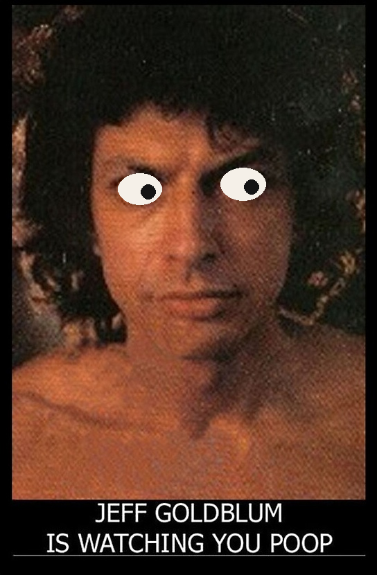

# jeff

An animated eye-contact version of the "Jeff Goldblum is watching you poop" meme.
A photo of Jeff Goldblum tracks your face with its eyes via camera, blinks, and
plays a random sound clip the first time you come into view.



All face tracking runs locally, in memory, per frame. Nothing is recorded,
stored, or sent anywhere.

## Setup

1. `python -m venv .venv && .venv/bin/pip install -r requirements.txt`
2. Download the face landmark model:
   ```bash
   mkdir -p models
   curl -sL -o models/face_landmarker.task \
     https://storage.googleapis.com/mediapipe-models/face_landmarker/face_landmarker/float16/1/face_landmarker.task
   ```
3. `python main.py`

Quit with Escape, the window close button, or Ctrl+C.

## Options

| Flag | Default | What it does |
|---|---|---|
| `--fullscreen` | off | Kiosk mode, scaled to the display |
| `--debug` | off | Local-only window showing the camera feed and tracked nose |
| `--mirror` / `--no-mirror` | `--no-mirror` | Flip horizontal tracking if the eyes follow the wrong way on your camera/display layout |
| `--camera-index N` | 0 | Which camera to use |
| `--cooldown SECONDS` | 60 | Minimum time between greeting sounds |
| `--fps N` | 15 | Tracking/render frame rate cap |
| `--smoothing-alpha X` | 0.3 | Pupil smoothing (lower = floatier) |
| `--image / --calibration / --sounds-dir` | repo paths | Swap in your own assets |

## Using your own photo or sounds

- Drop any front-facing photo in `assets/`, then `python tools/crop_image.py <photo>`
  to trim margins and `python tools/autocalibrate.py <photo>` to find the eyes
  (or `python tools/calibrate.py <photo>` to click them manually).
- Drop `.wav`/`.ogg`/`.mp3` clips in `sounds/` — one plays per new visitor,
  avoiding back-to-back repeats when more than one clip exists.

## Tests

```bash
.venv/bin/python -m pytest
```

## Deploying on a Raspberry Pi

Pi 4/5 recommended. Same setup as above, plus autostart — e.g. a systemd unit:

```ini
# /etc/systemd/system/jeff.service
[Unit]
Description=jeff
After=graphical.target

[Service]
User=pi
Environment=DISPLAY=:0
WorkingDirectory=/home/pi/jeff
ExecStart=/home/pi/jeff/.venv/bin/python main.py --fullscreen
Restart=on-failure

[Install]
WantedBy=graphical.target
```

Mount the camera at the top of the display, roughly where the eyes are. If the
eyes track the wrong way horizontally in your mounting arrangement, add
`--mirror`.

## Credits

The photo is a still from *The Fly* (1986); the meme dates back to a 2002
Geocities page. Sound clips are excerpts from Jeff Goldblum films. This is a
fan-made parody with no affiliation to Jeff Goldblum or any studio; code is
MIT-licensed (see LICENSE — media assets excluded).
